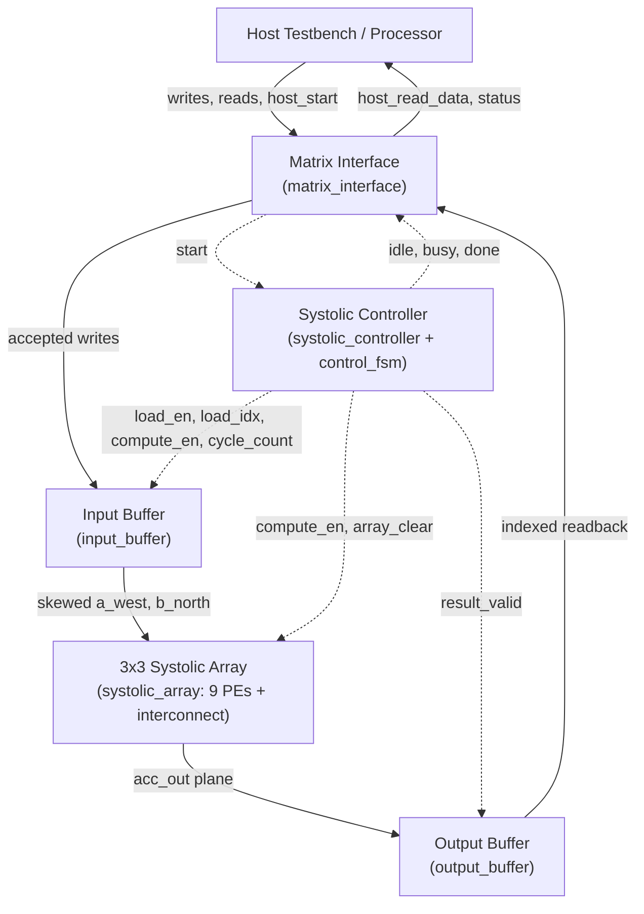
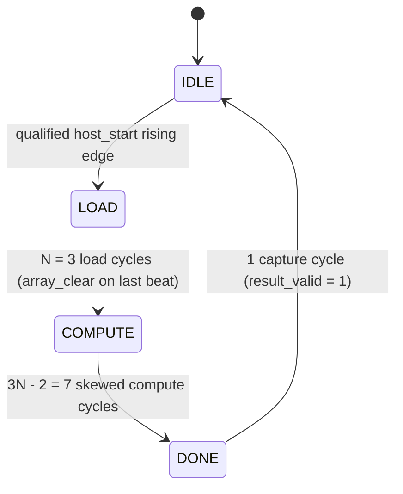

# Systolic Array Matrix Multiplication Accelerator

A synthesizable, parameterized **3×3 Output-Stationary Systolic Array Matrix Multiplication Accelerator** in Verilog HDL, developed as a B.Tech Modern Computer Architecture (MCA) project with optional tiled matrix multiplication, burst host interface, sequential baseline comparison, and Yosys FPGA synthesis evaluation.

---

## 1. Project Overview

Dense matrix multiplication $C = A \times B$ is compute-intensive ($N^3$ multiply-accumulate operations on $N^2$ result elements), making conventional sequential processors bottlenecked by repeated operand fetches and limited arithmetic units.

This project implements a **2D output-stationary systolic array accelerator** in synthesizable Verilog HDL (`top_module`). Processing elements (PEs) remain stationary on individual accumulator elements $C[i][j]$ while signed 8-bit matrix operands $A$ and $B$ stream rhythmically eastward and southward across registered neighbor links, achieving deterministic parallel execution without global operand broadcast buses.

The repository keeps the **3×3 core accelerator** as the primary, self-contained design and organizes additional scalability, host-interface, baseline-benchmarking, and FPGA characterization work cleanly as optional extensions.

---

## 2. Project Objectives

- Implement a 2D mesh of **processing elements (PEs)** with local neighbor operand registration.
- Implement signed **multiply-accumulate (MAC)** arithmetic units with full-precision products and 32-bit accumulators.
- Demonstrate rhythmic **systolic data movement** across row and column boundaries via skewed input streams.
- Perform deterministic signed **3×3 matrix multiplication** end-to-end through a verified host interface.
- Evaluate **latency and throughput** across load, compute, readback, and end-to-end boundaries.
- Compare systolic acceleration against a genuinely **sequential single-MAC GEMM baseline**.
- Evaluate **FPGA resource utilization** and pre-placement structural logic depth using available synthesis tools.

---

## 3. System Architecture

The primary accelerator (`top_module`, [`rtl/core/top_module.v`](rtl/core/top_module.v)) separates the compute core (`rtl/core/`) from data management (`rtl/interface/`):

- **Processing Elements (`processing_element`):** Register incoming `A` operands eastward and `B` operands southward on `compute_en`, while feeding current inputs combinationally into their local MAC unit.
- **MAC Units (`mac_unit`):** Multiply two 8-bit signed operands (`16`-bit full product) and accumulate into a `32`-bit signed register (`acc`), with active-low async `rst_n` and synchronous `clr` priority over `en`.
- **PE Interconnect (`pe_interconnect`) & Array (`systolic_array`):** Structural $3 \times 3$ grid connecting west/north skewed inputs and purely registered PE-to-PE links.
- **Systolic Controller (`systolic_controller`, `control_fsm`):** Control-only 4-state Moore FSM (`IDLE` → `LOAD` → `COMPUTE` → `DONE`) with start rising-edge lockout.
- **Input Buffer (`input_buffer`):** Stores $3 \times 3$ matrices `A` and `B`, tracks per-element readiness (`matrices_ready`), stages rows/columns during `LOAD`, and generates diagonal skewed boundary streams during `COMPUTE`.
- **Output Buffer (`output_buffer`):** Snapshots all 9 PE accumulators on `result_valid` and provides synchronous indexed readback (`read_valid`).
- **Matrix Interface (`matrix_interface`):** Qualifies host writes, start pulses, invalidations, and result readback.





---

## 4. Phase I — Core Systolic Array Implementation

Phase I forms the foundational MCA B.Tech core implementation, documented alongside the Phase II extensions in the final combined Phase I + Phase II IEEE project report ([`report/report.pdf`](report/report.pdf)) and [`docs/architecture/core_architecture.md`](docs/architecture/core_architecture.md).

- **Verified Default Configuration:** $3 \times 3$ output-stationary array, 8-bit signed two's-complement operands, 32-bit signed accumulators ($T_{\text{ctrl}} = 4N - 1 = 11$ cycles: `LOAD=3`, `COMPUTE=7`, `DONE=1`).
- **Core 3×3 Demonstration Flow (`make demo`):**
  1. Reset the accelerator (`rst_n`).
  2. Load two $3 \times 3$ signed matrices (`A` and `B`) via row-major writes (`18` write beats).
  3. Assert `host_start` (`start_ack` acknowledges).
  4. Propagate skewed operands through the 9 PEs (`3` load + `7` compute + `1` capture cycles).
  5. Read back the captured $3 \times 3$ output matrix `C` (`9` read beats).
  6. Compare every output element against an independent software reference calculation.
- **Core Verification (`make test-core`):** All 6 Phase I testbenches (`tb_mac_unit`, `tb_processing_element`, `tb_systolic_array`, `tb_systolic_controller`, `tb_data_management`, `tb_top_module`) pass with **376 counted checks** (0 failures) plus the **94-cycle** cycle-accurate controller suite, including a parameterized $2 \times 2$ array verification.

---

## 5. Phase II — Extensions and Performance Evaluation

Phase II adds optional scalability, interface, benchmarking, and FPGA characterization extensions while leaving the Phase I core RTL (`rtl/core/`, `rtl/interface/`) unmodified. See [`docs/architecture/extensions.md`](docs/architecture/extensions.md) and [`docs/project/phase_history.md`](docs/project/phase_history.md) for details.

- **Extension A — Tiled Matrix Multiplication (Optional):**
  [`tiled_gemm_top.v`](rtl/extensions/tiled_gemm_top.v), [`matrix_tiling_controller.v`](rtl/extensions/matrix_tiling_controller.v), [`tiled_input_buffer.v`](rtl/extensions/tiled_input_buffer.v), and [`partial_result_buffer.v`](rtl/extensions/partial_result_buffer.v) support **3×3** (`1` tile) and **6×6** (`8` tiles) matrix multiplication on the unmodified 3×3 systolic array (`1,164` checks passed).
- **Extension B — Advanced Burst Host Interface (Optional):**
  [`burst_matrix_interface.v`](rtl/extensions/burst_matrix_interface.v) and integrated [`integrated_gemm_top.v`](rtl/extensions/integrated_gemm_top.v) add streaming and 32-bit packed-word bursts (`4` elements/word), error codes, and a 2-stage lossless readback skid buffer (`215` + `808` checks passed).
- **Extension C — Sequential GEMM Baseline:**
  [`sequential_gemm.v`](rtl/baseline/sequential_gemm.v) implements a single-MAC sequential baseline ($T_{\text{comp}} = M^3$) under identical operand precision and host semantics (`636` checks passed).
- **Performance Comparison:**
  [`tb_performance.v`](testbench/extensions/tb_performance.v) and [`docs/performance/performance_analysis.md`](docs/performance/performance_analysis.md) quantify cycle latency, MAC throughput, and sequential speedup across 3×3 and 6×6 workloads (`240` checks passed).
- **FPGA Evaluation:**
  Technology-mapped Yosys synthesis (`xc7` and `ecp5`), hierarchical resource attribution, and structural logic-depth analysis in [`fpga/`](fpga/README.md).

---

## 6. Performance Results

Verified RTL simulation cycle counts across the primary 3×3 architecture and optional 6×6 extension:

| Architecture | Matrix | Compute cycles | End-to-end cycles |
|---|---|---:|---:|
| Sequential | 3×3 | 27 | 56 |
| Standalone systolic | 3×3 | 11 | 40 |
| Tiled systolic | 3×3 | 15 | 44 |
| Sequential | 6×6 | 216 | 326 |
| Tiled systolic | 6×6 | 113 | 223 |

- **3×3 Core Speedup:** The standalone 3×3 systolic array cuts compute latency from 27 to 11 cycles (**2.4545×** compute speedup) and seamless end-to-end latency from 56 to 40 cycles (**1.4000×** E2E speedup). Single-element I/O transport accounts for 27 of 38 active cycles (71.1%).
- **6×6 Tiled Speedup (Optional Extension):** Multi-tile execution cuts compute latency from 216 to 113 cycles (**1.9115×** compute speedup) and seamless E2E latency from 326 to 223 cycles (**1.4619×** E2E speedup), amortizing I/O overhead (`0.9686` vs. `0.6136` E2E MACs/cycle).
- **Reference Clock Scope:** Throughput figures (`245.45` MMAC/s 3×3 standalone compute; `191.15` MMAC/s 6×6 tiled compute) reported in [`docs/performance/performance_analysis.md`](docs/performance/performance_analysis.md) assume a nominal **100.0 MHz** simulation reference clock and are **not** measured FPGA frequencies.

---

## 7. FPGA Evaluation

Open-source technology-mapped synthesis (`Yosys 0.71+post`, `synth_xilinx -family xc7`, flattened with I/O pads) yielded the following pre-placement primitive counts:

| Top Module | Slice LUTs | Flip-Flops | `DSP48E1` | BRAM | `CARRY4` | I/Os |
| :--- | ---: | ---: | ---: | ---: | ---: | ---: |
| `top_module` (Core 3×3) | **1,145** | **1,026** | **9** | 0 | 16 | 63 |
| `sequential_gemm` (Baseline) | 1,351 | 1,882 | 1 | 0 | 27 | 71 |
| `tiled_gemm_top` (Tiled Ext.) | 10,698 | 2,388 | 17 | 0 | 192 | 71 |
| `integrated_gemm_top` (Integrated Ext.) | 12,919 | 2,549 | 19 | 0 | 234 | 120 |

- **Key Resource Findings:** The 3×3 core (`top_module`) is compact (`1,145` LUTs, `9` `DSP48E1`). In the integrated extension (`integrated_gemm_top`), `partial_result_buffer` accounts for `88.2%` of hierarchical LUTs (`14,911`) due to 9-way parallel dynamic-index read-modify-write muxes, the `10` additional `DSP48E1` slices (`19` total vs. `9` MAC DSPs) are likely inferred from `integer * matrix_dim` index arithmetic in `partial_result_buffer` and `tiled_input_buffer` (an inferred explanation from Yosys multiplier mapping logs rather than a confirmed attribution), and async `rst_n` `for`-loop resets prevent BRAM inference (`0` BRAM).
- **Important Limitations:** Because no target FPGA part or board is specified in the project and vendor PnR/STA tools (`Vivado`, `Quartus`, `nextpnr`) and FPGA hardware are unavailable in this environment, **vendor synthesis, place-and-route, post-implementation $F_{\max}$, bitstream generation, and physical FPGA hardware testing were NOT RUN**.

Full reports and details: [`fpga/README.md`](fpga/README.md) and [`fpga/RESULTS_SUMMARY.md`](fpga/RESULTS_SUMMARY.md).

---

## 8. Repository Structure

```text
Systolic-Array-Accelerator/
├── .github/
│   └── workflows/
│       └── ci.yml                 # Automated simulation, lint & Yosys synthesis CI
├── README.md
├── Makefile
├── .gitignore
├── rtl/
│   ├── core/                    # Phase I core 3x3 systolic array & controller
│   │   ├── mac_unit.v
│   │   ├── processing_element.v
│   │   ├── pe_interconnect.v
│   │   ├── systolic_array.v
│   │   ├── control_fsm.v
│   │   ├── systolic_controller.v
│   │   └── top_module.v
│   ├── interface/               # Phase I buffers & host interface
│   │   ├── input_buffer.v
│   │   ├── output_buffer.v
│   │   └── matrix_interface.v
│   ├── extensions/              # Optional Phase II tiling & burst extensions
│   │   ├── matrix_tiling_controller.v
│   │   ├── tiled_input_buffer.v
│   │   ├── partial_result_buffer.v
│   │   ├── tiled_gemm_top.v
│   │   ├── burst_matrix_interface.v
│   │   └── integrated_gemm_top.v
│   └── baseline/                # Sequential single-MAC reference baseline
│       └── sequential_gemm.v
├── testbench/
│   ├── core/                    # Core unit, top-level & 3x3 demo testbenches
│   ├── interface/               # Data-management subsystem testbench
│   ├── extensions/              # Tiled, burst, integration & performance testbenches
│   └── baseline/                # Sequential baseline testbench
├── fpga/                        # Yosys FPGA synthesis scripts & reports
│   ├── README.md
│   ├── RESULTS_SUMMARY.md
│   ├── fpga_config.mk
│   ├── scripts/
│   └── reports/
├── docs/
│   ├── architecture/            # Core & extension architecture documentation
│   ├── performance/             # Latency, throughput & speedup analysis
│   └── project/                 # Phase I / Phase II history & layout mapping
├── report/
│   └── report.pdf               # Final combined Phase I + Phase II IEEE project report
└── build/                       # Generated simulation/synthesis artifacts (gitignored)
```

---

## 9. Requirements and Tools

- **Simulation (Required):** Icarus Verilog (`iverilog` with `-g2012 -Wall` and `vvp`), GNU Make.
- **RTL Structural & Open-Source FPGA Synthesis (Optional):** Yosys (`yosys` 0.71+ with `yosys-abc`), Python 3.
- **Vendor Implementation & Board Testing (Optional, Not Installed Here):** Xilinx Vivado / Intel Quartus / `nextpnr`, official board constraint file (`.xdc`/`.sdc`), and a physical FPGA board.

---

## 10. How to Run

```bash
# 1. Core 3x3 systolic array demonstration
make demo

# 2. Core Phase I tests (MAC, PE, array, controller, data interface, top_module)
make test-core

# 3. Optional extension tests (tiling, burst interface, integrated_gemm_top, performance)
make test-extensions

# 4. Sequential GEMM baseline tests
make test-baseline

# 5. Complete functional regression suite (core + extensions + baseline)
make test

# 6. Structural RTL checks & Yosys FPGA evaluation
make synth-check
make synth-fpga
make fpga-utilization
make fpga-path-analysis

# Clean generated build artifacts
make clean
```

Additional structural targets: `make synth-check-tiled`, `make synth-check-integrated`, `make synth-check-baseline`. Vendor STA/bitstream targets (`make fpga-timing`, `make fpga-bitstream`) report explicit `NOT RUN` diagnostics when vendor tools or target device/constraints are absent.

---

## 11. Project Deliverables

- **Final Combined IEEE Project Report (Phase I + Phase II):** [View Project Report](report/report.pdf)
- **Demonstration Video (Phase I):** [Watch Presentation Video](https://drive.google.com/file/d/1x2GeWZgQnMK2wWIYd1ib1YpxJbkEby2q/view?usp=sharing)
- **Core Architecture Documentation:** [`docs/architecture/core_architecture.md`](docs/architecture/core_architecture.md)
- **Extension Architecture Documentation:** [`docs/architecture/extensions.md`](docs/architecture/extensions.md)
- **Performance & Baseline Analysis:** [`docs/performance/performance_analysis.md`](docs/performance/performance_analysis.md)
- **Phase History & Layout Map:** [`docs/project/phase_history.md`](docs/project/phase_history.md)
- **FPGA Evaluation Reports:** [`fpga/README.md`](fpga/README.md) | [`fpga/RESULTS_SUMMARY.md`](fpga/RESULTS_SUMMARY.md)

---

## 12. Limitations and Future Work

1. **No Physical FPGA Implementation or Timing Closure:** Target FPGA part/board are unspecified and vendor PnR/STA tools and physical hardware are unavailable; post-implementation $F_{\max}$, slack, power, and on-board validation remain unperformed.
2. **Equal-Clock Throughput Assumption:** Performance `MMAC/s` comparisons assume a nominal `100.0 MHz` reference clock; actual wall-clock FPGA speedup requires post-PnR timing analysis.
3. **Fixed Physical Array & Dataflow:** The verified top-level core is $3 \times 3$ output-stationary without sparsity support, overflow saturation, or double-buffered load/compute overlap; extension tiling supports $3 \times 3$ and $6 \times 6$ only.
4. **Extension Area/Path Optimization Opportunity:** Refactoring `partial_result_buffer` addressing and synchronous resets would reduce extension LUT/DSP usage and potentially allow BRAM/DSP register packing in future work.
