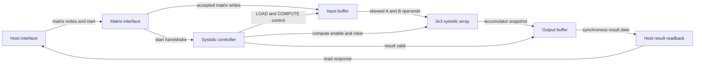
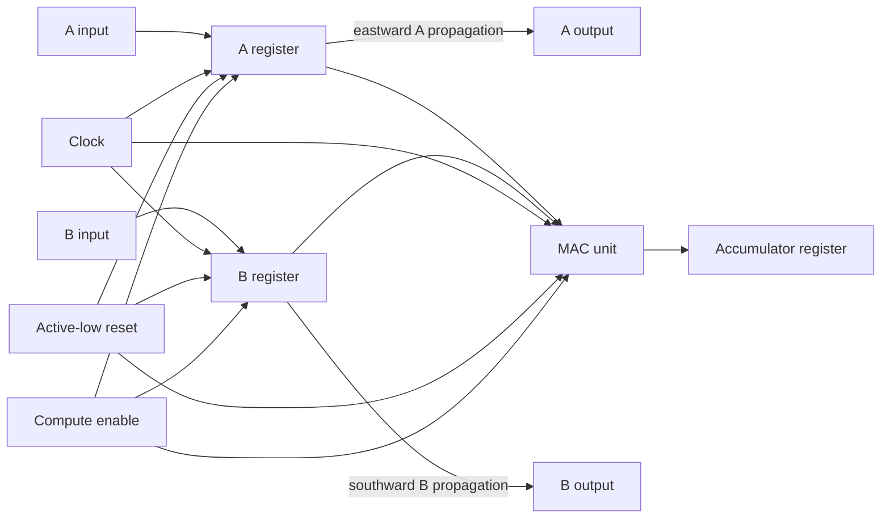
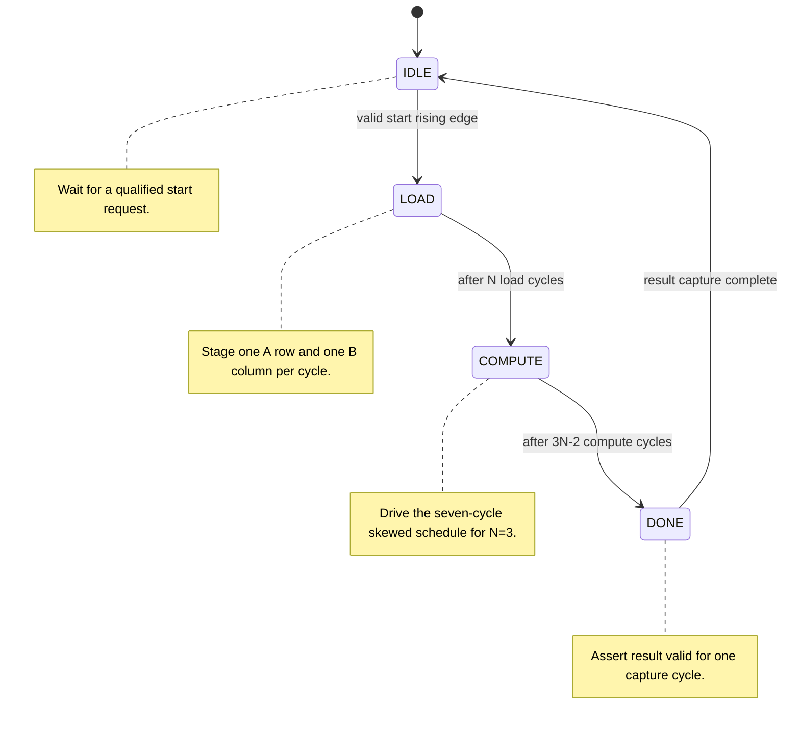

# Systolic Array Matrix Multiplication Accelerator

This repository contains a synthesizable, parameterized systolic-array
accelerator for signed matrix multiplication. The verified default system is
a 3x3 output-stationary array with 8-bit signed inputs and 32-bit signed
accumulators.

## Architecture

The integrated data path is:

```text
Host interface -> Input buffer -> Systolic controller -> Systolic array
                                                        -> Output buffer
Host readback  <----------------------------------------+
```

The MAC unit performs signed multiply-accumulate operations inside each
processing element. Processing elements register A operands eastward and B
operands southward. The interconnect routes these registered links across the
array. The controller sequences loading, computation, and result capture.
The input buffer stores matrices and generates the skewed boundary streams;
the output buffer snapshots the completed accumulators and provides indexed
host readback.

### System architecture



The matrix interface qualifies host requests and connects the host-facing
control protocol to the controller and data buffers. Controller signals are
shown separately from operand and result data paths.

### Processing-element dataflow



Each processing element registers operands for neighbor propagation while
the MAC unit accumulates the product into the output-stationary accumulator.

### Controller states



## Design configuration

- Array: 3x3 by default.
- Input operands: 8-bit signed two's-complement values.
- Product: 16-bit signed multiplication result.
- Accumulators: 32-bit signed values.
- Dataflow: output-stationary.
- Array core: parameterized by array size and data/accumulator widths.

The integrated top-level verification targets the default configuration.
The lower-level array testbench also exercises a 2x2 parameterization.

## Data movement and timing

Host matrix addresses are row-major:
`address = row * ARRAY_SIZE + column`.

During LOAD, one A row and one B column are staged per cycle. During COMPUTE,
the input buffer drives only valid skewed operands:

```text
a_west[i]  = A[i][cycle_count - i]
b_north[j] = B[cycle_count - j][j]
```

Values outside the matrix bounds are zero. A operands move eastward and B
operands move southward through registered processing-element links.

For an N x N array:

- LOAD lasts N cycles.
- COMPUTE lasts 3N - 2 cycles.
- DONE lasts one cycle while the result is captured.

For the verified 3x3 system, the schedule is LOAD=3 cycles,
COMPUTE=7 cycles, and DONE=1 cycle. The final LOAD beat asserts the
accumulator clear; computation then proceeds without an additional pipeline
stage.

## Host interface

The top-level `top_module` provides:

- Active-low asynchronous reset and clock.
- Matrix write enable, A/B selection, row-major address, data, and
  write acknowledgement.
- Matrix readiness, ready, busy, done, start acknowledgement, and start
  error status.
- Start edge detection with reset lockout and held-high suppression.
- Result availability and synchronous indexed result readback.

Writes are accepted only while the controller is idle and the address is
valid. A start is accepted only when both matrices are complete and the
controller is idle. Invalid starts and writes are rejected. Reads before a
valid result or at an invalid address do not assert `read_valid`.

## Repository structure

```text
.
├── .gitignore
├── Makefile
├── README.md
├── rtl
│   ├── mac_unit.v
│   ├── processing_element.v
│   ├── pe_interconnect.v
│   ├── systolic_array.v
│   ├── control_fsm.v
│   ├── systolic_controller.v
│   ├── input_buffer.v
│   ├── output_buffer.v
│   ├── matrix_interface.v
│   └── top_module.v
├── testbench
│   ├── tb_mac_unit.v
│   ├── tb_processing_element.v
│   ├── tb_systolic_array.v
│   ├── tb_systolic_controller.v
│   ├── tb_data_management.v
│   └── tb_top_module.v
└── build
```

`build/` is reserved for generated simulation executables, logs, and
waveforms. These generated files are ignored by Git.

## Requirements

- Icarus Verilog with `vvp`.
- Yosys for structural RTL checking.
- GNU Make.

## Build and simulation

Run the complete regression:

```sh
make test
```

Run individual suites:

```sh
make test-mac
make test-pe
make test-array
make test-controller
make test-data
make test-top
```

Run the integrated structural check:

```sh
make synth-check
```

Remove generated outputs:

```sh
make clean
```

## Verification results

The verified regression results are:

- MAC unit: 32 checks passed.
- Processing element: 26 checks passed.
- Systolic array: 77 checks passed.
- Controller: pass; LOAD=3 and COMPUTE=7 for the default system.
- Data management: 80 passed, 0 failed.
- Integrated top-level: 161 checks passed, 0 failed.

The integrated testbench independently calculates and reads back both
positive and signed matrix products, and checks invalid accesses, back-to-back
operations, held-high starts, and reset during computation.

## Example matrix multiplication

```text
A =              B =
1 2 3            9 8 7
4 5 6            6 5 4
7 8 9            3 2 1
```

The expected result is:

```text
C =
30  24  18
84  69  54
138 114 90
```

The integrated verification also covers:

```text
A =              B =
 2 -1  3          1  2 -1
 0  4 -2         -2  0  3
-3  5  1          4 -1  2
```

with expected result:

```text
 16  1  1
-16  2  8
 -9 -7 20
```

## Current scope and limitations

Phase I demonstrates synthesizable RTL simulation of the integrated default
3x3 accelerator and structural checking with Yosys. It does not claim FPGA
hardware operation, place-and-route, timing closure, clock frequency,
resource utilization, or silicon measurements. Parameterized lower-level
blocks are tested, but every possible top-level parameter combination is not
certified by the integrated testbench.

## Future development

Future work may include FPGA implementation, device-specific synthesis,
static timing analysis, resource analysis, larger matrix tiling, improved
host transport, and throughput/power optimization.
